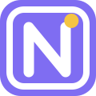

# NewsDesk RSS Dashboard

NewsDesk is a free open-source feed reader for Windows, with NO ads, trackers, or pop-ups. Unzip it, double-click, and read. Nothing gets installed, and
everything stays on your computer.

> **Credit.** The layout and workflow are modeled on
> [RSS Dashboard for Obsidian](https://github.com/amatya-aditya/obsidian-rss-dashboard) by
> [amatya-aditya](https://github.com/amatya-aditya). Thank you for a great design. This is
> a separate project: it shares no code with the plugin and isn't affiliated with or
> endorsed by its author or by Obsidian. If you use Obsidian, try the original plugin.

## Features

- **Three layouts:** a card grid with thumbnails, a compact list, and a one-column feed.
  Articles can be grouped by date, by feed, or both, under headers you can fold away.
- **Reader pane** that opens beside the list, with **Load full article** for feeds that
  only send a preview.
- **Folders** and subfolders, organized by drag and drop, with unread counts.
- **Stars, colored tags, search and filters** (unread or read, date, starred, tags).
- **Save as Markdown** with YAML frontmatter, ready for Obsidian or any notes app.
- **OPML import and export**, so you can move feeds in from another reader and back out.
- **Paste any website address** and the app finds its feed.
- **Works behind proxies and TLS inspection** by falling back to the same Windows
  networking Edge uses.
- Light and dark themes, plus keyboard shortcuts.

## Get started

1. Download `NewsDesk-<version>.zip` from the [latest release](../../releases/latest).
2. Unzip it, open the **NewsDesk** folder and double-click **Install NewsDesk**. Windows
   asks once whether to run a script from an unverified publisher; click **Run**. To skip
   that prompt, right-click the zip, choose **Properties > Unblock** before unzipping.
3. Start NewsDesk from the new desktop or Start menu shortcut. Click
   **Add the starter feeds**, **Add a feed**, or **Import a file**.

The installer copies the app to `%LOCALAPPDATA%\Programs\NewsDesk` and adds the two
shortcuts. It needs no admin rights and writes nothing to the registry. To try NewsDesk
without installing, double-click **Start NewsDesk** in the unzipped folder instead.

The [user guide](USER-GUIDE.md) covers everyday use, updating, uninstalling, and what to
do if something goes wrong. It's also inside the zip as `README.md`.

**Requirements:** Windows 10 or 11. The app opens in Microsoft Edge, which Windows
includes, or in your default browser if Edge isn't there.

## Privacy

- The app runs a small server that only your own computer can reach.
- It downloads the feeds you add, plus the full article from the website when you ask.
- Like any web page, articles can show images and media hosted on other sites, and those
  sites see the request. Turn on **Settings > Hide images from websites** to block them.
- Once a day it asks GitHub whether a newer NewsDesk has been released. You can turn that
  off in **Settings > Help**. Updates are never downloaded or installed automatically.
- **Test connection** in Settings downloads one test feed, from arstechnica.com.
- Your feeds, articles and settings live in `%APPDATA%\NewsDesk`. NewsDesk itself sends
  your data nowhere, and there are no accounts, ads or tracking.

## Problems and ideas

Open an issue on this repository. For feeds that won't update, include a screenshot of
**Settings > Connection > Test connection**. Security problems should be reported
privately instead: see [SECURITY.md](SECURITY.md).

## For developers

Run from source with `py -3 app\launcher.py`, run the tests with
`py -3 -m unittest discover -s tests -t tests`, and build the portable zip with
`pwsh -File .\build_portable.ps1 -Test`.
[docs/ARCHITECTURE.md](docs/ARCHITECTURE.md) explains how it works, the design decisions,
and the security model. Bundled third-party components and their licenses are listed in
[THIRD-PARTY.md](THIRD-PARTY.md).

## License

[MIT](LICENSE) © 2026 Stephen McGann. The bundled third-party components keep their own
licenses, listed in [THIRD-PARTY.md](THIRD-PARTY.md).
